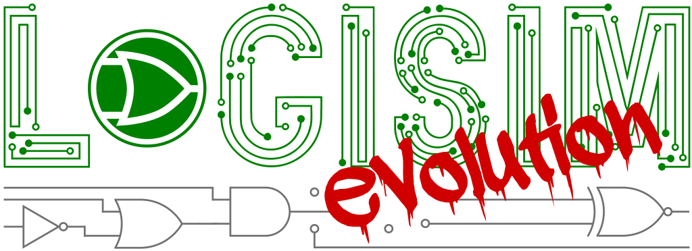

# Changes #

* @dev (????-??-??)
  * A circuit can be renamed. There was no rename anywhere in the program: the only way was to
    click empty canvas so the properties panel fell back to the circuit's own properties, then edit
    the name row. It is now F2 and a Rename item in the Circuits panel, as one undoable step
    (@YOUR_GITHUB_HANDLE).
  * The Properties panel and the bottom drawer can be put away again. Their visibility was
    modelled and remembered between sessions but wired to no control, so once either was on screen
    it stayed there (@YOUR_GITHUB_HANDLE).
  * The shell answers the keyboard. The activity bar down the left edge can be focused and used
    with Enter or Space and announces itself to a screen reader; the editor tabs answer Ctrl+Tab,
    Ctrl+Shift+Tab and Ctrl+W and offer Close / Close Others / Close All; the Circuits list answers
    F2 and Delete; and typing in either filter and pressing Enter now takes the first match instead
    of doing nothing, with Down moving into the list or the grid (@YOUR_GITHUB_HANDLE).
  * Circuit Statistics and Export Circuit are in the Circuits panel's menu. Exporting a single
    circuit had been reachable only by switching the component panel back to the old library tree
    (@YOUR_GITHUB_HANDLE).
  * The last of the 2005 palette is gone from the windows around the canvas. The main toolbar
    filled a solid magenta square behind the tool whose properties were showing -- hiding the icon
    it was meant to point at -- and now tints it the way a palette tile does. The simulator's three
    canvas markers were raw red, blue and magenta, the last with the original author's "fixme"
    beside it; they are now error, accent and warning from the design system, and become plain ink
    when printing. The off-screen-content arrows were a 36%-alpha navy still named after the tick
    rate (@YOUR_GITHUB_HANDLE).
  * The timing diagram was the only part of the program still asking for a serif face: italic Serif
    for its messages and for the whole time ruler, at a size that ignored the interface scale. It
    now uses the interface font, and the ruler the monospaced one so its figures line up. Its ruler
    drew in black and its cursor was a red hairline with a yellow badge; both follow the theme
    (@YOUR_GITHUB_HANDLE).
  * Fixed: the Test Vector table drew every value, heading and rule in black, so on a dark window
    it was black on black. Its three status colours were pastels chosen by colour name -- pink,
    mint, lavender -- and are now error, success and the badge colour (@YOUR_GITHUB_HANDLE).
  * K-map entries were drawn in pure blue, the original Logisim colour; the truth table's rules
    were hardcoded grey next to a themed selection; the timing signal tree hand-drew its own blue
    disclosure triangle outlined in black; a sub-signal was a magenta placeholder square positioned
    with its x coordinate passed for y; and the HDL toolbar's three buttons were hand-painted white
    pages with a red tick and a magenta arrow. All now come from the design system
    (@YOUR_GITHUB_HANDLE).
  * Removed a magenta-on-black debug marker that was still live in the FPGA report list, colouring
    any row whose text happened to contain "BUG" (@YOUR_GITHUB_HANDLE).
  * Fixed: turning the mouse wheel over a numeric property wrote every value it passed through, so
    spinning a bit width from 1 to 16 left fifteen separate entries in the undo history and asked
    the circuit to re-fit its wires fifteen times. The number now moves as the wheel turns and is
    written once, when the wheel stops (@YOUR_GITHUB_HANDLE).
  * Fixed: the wheel decided whether a property could go below one by looking for the word "width"
    in the property's *translated* name. It therefore did nothing in any language but English, and
    clamped unrelated properties whose translated name happened to contain that word. Properties
    that have limits now say so, through the new `BoundedAttribute` (@YOUR_GITHUB_HANDLE).
  * Fixed: a value the component refused during a wheel change was discarded silently and the
    number simply snapped back. It now says why (@YOUR_GITHUB_HANDLE).
  * Selecting several rows and setting them together used to work only for a splitter's bit rows.
    It now works for any rows offering the same choices -- eight pins' data widths, four gates'
    facing (@YOUR_GITHUB_HANDLE).
  * When several selected components disagree about a property, the panel says "(various)" instead
    of showing an empty cell, which was indistinguishable from a property with no value
    (@YOUR_GITHUB_HANDLE).
  * Fixed: twenty-seven places in the component painters drew in pure black whatever the theme, so
    on a dark canvas a register's contents, a counter's mode labels, a RAM's cells, the value on a
    poked memory or register, a probe's reading, a constant's value and the TTL chips' captions
    were black on black. They now use the theme's component colour, as the shared drawing code
    already did. Components that fill a surface of their own first -- the video screen, the
    oscilloscope's white trace area, the PLA editor, a keypad's coloured keys -- still draw in
    black on it, which is correct (@YOUR_GITHUB_HANDLE).
  * The English wording has been rewritten to use words people already know instead of words this
    program invented: Poke is Interact, Toolbox is Components, Plexers are Multiplexers, Radix is
    Number base, Attributes are Properties, "Add Circuit" is "New Circuit", and "Raise To Top" is
    "Bring to Front". `docs/glossary.md` lists every change so course material can be brought up
    to date. No key was renamed and no identifier changed, so the twelve translations keep
    working and fall back to English for the text they have not been given yet
    (@YOUR_GITHUB_HANDLE).
  * Fixed: six pieces of text were asked for under a name no bundle had, so the program showed the
    name itself where a sentence should be — among them the LED Bar's name in the appearance
    editor and the caption on the Real Time Clock. A test now checks every one of the several
    thousand lookups in the program (@YOUR_GITHUB_HANDLE).
  * The component library is now a palette of tiles showing each component's own symbol, grouped
    by what the components are for -- Logic, Wiring & routing, Arithmetic, Memory, Input & output,
    Displays, Chips & TTL, Advanced -- instead of a folder tree of several hundred identical rows
    grouped by the part of the program they live in. Components can be pinned to the top, and the
    ones used most recently appear there on their own. The library tree is still available from a
    button in the panel's heading, since it is where a library is unloaded or reordered
    (@YOUR_GITHUB_HANDLE).
  * The grouping is a presentation layer only: library identifiers, the contents of a `.circ` file
    and the structure of the built-in libraries are unchanged, and a library the palette does not
    recognise keeps all of its components under its own name (@YOUR_GITHUB_HANDLE).
  * The buttons for adding, reordering and removing a circuit have moved from the component panel,
    where they had nothing to do with what was below them, to the heading of the Circuits panel
    (@YOUR_GITHUB_HANDLE).
  * The circuit canvas has been redrawn. Lines end and meet in rounded joins, component bodies
    have rounded corners, selection handles are filled discs in the accent colour instead of
    white squares with a black outline that were invisible on a dark canvas, the magenta
    rotated ellipse marking the component whose properties are shown is now a soft accent glow,
    and the grid has two levels so distance across the sheet can be judged at a glance
    (@YOUR_GITHUB_HANDLE).
  * Highlighting a wire no longer redraws it thicker and dashed, which made it look like a
    different kind of wire; a halo is drawn around it instead, so its apparent weight keeps
    meaning what it means. A bus is now clearly heavier than a wire rather than one pixel
    heavier (@YOUR_GITHUB_HANDLE).
  * The canvas palette has been retuned for both themes, replacing the pure-green, pure-magenta
    and pure-black values (@YOUR_GITHUB_HANDLE).
  * Fixed: printing and image export used the theme's colours for signal values, so a circuit
    exported while the dark theme was showing was drawn in near-white ink on a white page.
    Printing now uses its own palette, every colour of which is tested for contrast against
    white (@YOUR_GITHUB_HANDLE).
  * Fixed: a change announced by the preference store was recorded as a colour the user had
    chosen. Since such a notification carries no value, the colour recorded was the default the
    monitor was built with, which for the drawing colours is the light one: the dark theme
    ended up storing the light theme's ink and kept it through every later release
    (@YOUR_GITHUB_HANDLE).
  * Fixed: a junction dot shrank while a wire was being dragged, because the size factor was
    applied twice in one of the two places that draw it (@YOUR_GITHUB_HANDLE).
  * The floating auto-zoom button painted into the canvas corner has been removed; the zoom
    controls already float over the canvas (@YOUR_GITHUB_HANDLE).
  * The splash and about windows follow the theme instead of being white with a two-pixel
    black frame, and the about panel uses a real layout rather than fixed positions
    (@YOUR_GITHUB_HANDLE).
  * The preferences window has a list of pages with a filter instead of ten tabs whose names
    did not fit (@YOUR_GITHUB_HANDLE).
  * Starting without a file now opens a welcome screen offering a new project, a file to open
    and the projects you had open recently, instead of an empty grid (@YOUR_GITHUB_HANDLE).
  * The zoom controls float over the corner of the canvas instead of taking a strip of the
    side panel, and the properties panel no longer hides the state readout behind a tab
    (@YOUR_GITHUB_HANDLE).
  * The clock rate and the single-step message are shown in the status bar rather than painted
    over the circuit, the clock rate in 28-point monospace (@YOUR_GITHUB_HANDLE).
  * The side panel now has a Circuits view listing only what you have made, with a filter, so
    moving between circuits no longer means finding one in a tree that also holds every
    component library. Libraries and the running simulation are separate views
    (@YOUR_GITHUB_HANDLE).
  * Library folders are drawn as a plain outline in the interface colour instead of a yellow
    manila folder with a shadow (@YOUR_GITHUB_HANDLE).
  * The main window has been rebuilt. An activity bar chooses what the side panel shows, the
    circuits you open get tabs above the canvas, properties have their own panel on the right
    instead of sharing the left column, and a status bar reports the circuit, the zoom and what
    the simulation is doing. The simulation controls sit at the end of the toolbar, in one fixed
    place (@YOUR_GITHUB_HANDLE).
  * Panel sizes are remembered in pixels rather than as a share of the window, so the side panel
    no longer grows to a quarter of a wide screen (@YOUR_GITHUB_HANDLE).
  * The interface has two themes of its own, a light one and a dark one, and follows the
    desktop's light or dark setting by default. They replace the list of installed look and
    feels, which meant nothing the application drew itself could be designed to match. Menu,
    toolbar and panel icons are now drawn from a vector set, so they stay sharp at any size and
    take their colour from the theme (@YOUR_GITHUB_HANDLE).
  * A colour picked in the preferences is no longer thrown away when the theme changes. Each
    theme keeps its own set, so switching away and back brings your colours back
    (@YOUR_GITHUB_HANDLE).
  * Fixed the application refusing to start when run from a build directory: a class path entry
    that does not exist was opened as an archive while looking for FPGA boards
    (@YOUR_GITHUB_HANDLE).
  * The canvas auto-zoom button, the grid toggle icon, the hex editor selection, the FPGA
    settings borders and the FPGA report font now follow the look and feel and the interface
    scale. Several fonts requested the non-existent "Sans Serif" family and silently fell
    back to the default (@YOUR_GITHUB_HANDLE).
  * Dialogs now close on Escape and accept Enter for their OK button, the menu bar can be
    opened from the keyboard through Alt with a letter of each menu title in any language,
    toolbar buttons announce their name to screen readers, and an attribute value that is
    too long for its column is shown in full as a tooltip (@YOUR_GITHUB_HANDLE).
  * Every menu shortcut can now be changed in the hotkey settings, including New, Open,
    Save, Cut, Copy, Paste and the others that used to be fixed. Preferences, Add Circuit,
    Analyze Circuit, Circuit Statistics and Project Options gained shortcuts. Reset to
    defaults also no longer changes Close Window from Shift+Ctrl+W to Ctrl+W
    (@YOUR_GITHUB_HANDLE).
  * The Find Action search now also lists the circuits and VHDL entities of the project,
    the tabs of the preferences window and the recently opened files, so a circuit can
    be shown, a preference page opened or a recent project reopened by typing its name
    (@YOUR_GITHUB_HANDLE).
  * Logging to a file now reports when the file cannot be written instead of silently
    switching itself off. Failed attribute edits, an unreadable log file and a crashed
    simulator are reported with a title and the reason, a crash while opening a window
    shows a short message with the stack trace behind Details instead of the trace
    itself, and the pointer shows busy while a project is loaded or saved
    (@YOUR_GITHUB_HANDLE).
  * Errors are now reported with a title, an error icon and, where there is one, the
    underlying exception behind a Details button, instead of a bare message with no
    indication of what failed. A dialog with no parent window no longer opens behind the
    application (@YOUR_GITHUB_HANDLE).
  * Fixed the interface being scaled twice on high-DPI displays. The default scale was the
    screen height divided by a thousand, applied on top of the scaling the operating
    system already performs. It now defers to the platform, and a stored scale that the
    old formula chose is corrected once, leaving a scale you picked yourself alone
    (@YOUR_GITHUB_HANDLE).
  * Gave the preferences and project options panels consistent padding, so their contents no
    longer sit flush against the dialog edge (@YOUR_GITHUB_HANDLE).
  * The timing diagram now follows the active theme. Waveforms, bus value labels, row
    backgrounds and the signal name column were drawn in hardcoded black on white, which
    left the chronogram unreadable in a dark look and feel. Exported images keep the
    light palette so they still suit a printed document (@YOUR_GITHUB_HANDLE).
  * Improved canvas zooming and scrolling with a trackpad, which now follows the gesture
    smoothly instead of jumping a fixed step, and stopped the scroll position snapping
    back to the start at the end of its range [#1262] (@YOUR_GITHUB_HANDLE).
  * Fixed stray black strokes left on a dark canvas where the painter reset its colour
    to black rather than to the themed component colour (@YOUR_GITHUB_HANDLE).
  * Polished the main window chrome: the split pane divider is now visible at rest and its
    grab area follows the interface scale, and the docked tab strips use the shared
    typographic scale instead of a fixed nine point font (@YOUR_GITHUB_HANDLE).
  * Toolbar items now respond to the pointer, with hover, pressed and selected states drawn
    from the active theme instead of a hardcoded grey rectangle, and separators follow the
    theme's separator colour (@YOUR_GITHUB_HANDLE).
  * Replaced the fixed size Serif and monospaced fonts in the log tables, truth table,
    assembler and FPGA windows with a shared typographic scale that follows the look and
    feel and the interface scale preference (@YOUR_GITHUB_HANDLE).
  * Fixed the Design/Simulate tab labels ignoring the UI scale preference, which left them
    unreadably small on high-DPI displays (@YOUR_GITHUB_HANDLE).
  * Made the split pane drag indicator follow the active theme so it stays visible in dark
    look and feels (@YOUR_GITHUB_HANDLE).
  * Fixed loss of custom appearance when merging circuits into a project (@V-Zemlyakov).

* v5.0.0 (2026-09-12)
  * Improved visual representation of Pull Resistor component (@V-Zemlyakov).
  * Re-enabled SonarCloud analysis in the GitHub Actions build workflow (@zdimension).
  * Added anti-aliasing preference to control anti-aliasing of UI elements (@V-Zemlyakov).
  * Simplified Keyboard component buffer handling by removing redundant array-copy guards
    [#564] (@hewzhew).
  * Set default gate shape to rectangular (IEC) for Russian locale (@V-Zemlyakov).
  * Added a new signed/unsigned option to the multiplier component.(@Diogo-Valadares)
  * Added "Show Bus Width" wire attribute to label multi-bit buses with a tick mark at Start, Center, or End (@V-Zemlyakov).
  * Added Image component to insert custom bitmap images into circuits and subcircuit appearances.
  * Added contributor guidance and an online component overview for the TTL library.
  * Fixed packaged runtimes failing to launch when Java accessibility support is configured
    [#2398] (@hewzhew).
  * Added "Find Action" omni-search, letting menu actions be found and run by typing part of their
    name, with fuzzy and acronym matching (e.g. "expim" or "ei" find "Export Image"). It opens from
    the Help menu, from Ctrl+Shift+A (configurable under Preferences > Hotkey settings), or by
    tapping Shift twice (switchable under Preferences > Window). It is built as a hub over pluggable
    search providers, so further sources of results can be added without changing the dialog. Its
    Add provider can select components for placement from the project's open libraries.
  * Fixed FlatLaf "restricted native access" warning on newer Java versions.
  * Fixed HDL generator tests failing when the "Use upper case for VHDL keywords" preference is
    disabled (@MarcinOrlowski)
  * Improved file merging and export capabilities:
    * Added ability to selectively merge individual circuits and subcircuit dependencies from a Logisim file.
    * Added ability to export individual circuits along with dependent subcircuits into standalone Logisim files.
    * Added conflict resolution dialog to replace, rename, or skip conflicting circuits.
  * Added support for opening project files by dragging them into the application window.
  * Added a Window menu option to hide or show the navigation pane.
  * Added configurable shortcuts for selecting the default toolbar tools.
  * Added ability to load multiple RAM or ROM memories from the command line
  * Added an opt-in RAM data-bus mode where inactive output-enable drives separate outputs to high-impedance.
  * Added Real-Time Clock component.
  * Added Floating Point Constant component.
  * Added FPGA HDL support for the Bit Finder component [#2890] (@hewzhew).
  * Added 444 RGB (12 bit) color mode to the RGB Video component.
  * Modified paste behavior to paste at current mouse location if it is on canvas.
  * Added multiline Text Tool labels using Shift+Enter or multiline clipboard text.
  * Fixed a regression that caused TestVector to fail when the circuit had subcircuits.
  * Fixed TTL 7447 BI/RBO port to be an input/output port to allow cascading of blanking mode.
  * Added TTL 7476: dual J-K Flip-flop with preset and clear.
  * Added TTL 7493: 4-bit binary ripple counter.
  * Added TTL 7438: quad dual-input NAND gate, open collector.
  * Added TTL 74173: 4-bit D-type registers with 3-state outputs.
  * Improved drawing appearance:
    * Corrected font choice for default fonts in TikZ image exports.
    * Corrected disjoint corners on Square Root arithmetic components.
    * Corrected disjoint corners on unpressed Button components.
    * Reduced line reordering errors in TikZ/SVG image exports.
  * Improved dark theme (FlatLaf Dark / Darcula) color synchronization:
    * Canvas background, grid dots, component outlines, icons, and signal wire
      colors now adapt to the active theme.
    * Look and feel switching applies globally to all open windows without requiring
      a restart.
    * Fixed gate negation bubbles, K-map text, expression overlines, and splitter
      bit-range labels to be visible on dark backgrounds.
    * Replaced hard-coded hex color literals with named `DEFAULT_*`/`DARK_*` constants
      in class `AppPreferences`.
  * Added separate light and dark code editor theme preferences for HDL and assembly editors.
  * Improved Timing Diagram recording and exports:
    * Corrected vector and GIF exports.
    * Corrected reset offsets, non-50% duty-cycle clocks, real-time traces, and RAM memory traces.
  * Improved custom circuit appearance editing and dynamic appearance elements:
    * Circuit attributes are shown when no item is selected.
    * Dynamic elements preserve nested paths and can display nested Probe/Register values correctly.
    * Corrected drag selection, selected-object attributes, and automatic switching to custom appearance.
  * Improved memory and hex editor tools:
    * Added a go-to-address control to the hex editor.
    * Limited generated save previews for large memories.
    * Clarified RAM and Dual Port RAM simulation reset behavior labels.
    * Corrected memory display layout in exported graphics.
    * Wide Counter components use compact grouped state rows in evolution appearance.
    * RAM line-enable inputs now only write when enabled. Existing projects relying on unconnected
      line-enable inputs may need to connect those inputs explicitly.
    * Random Generator now uses xoshiro256++ to produce full-width 64-bit pseudorandom values in
      simulation and generated HDL.
  * Added HDL-language-aware label and circuit-name validation: VHDL remains case-insensitive,
    Verilog permits case-distinct names, and selecting no HDL permits non-HDL identifiers.
  * Fixed several HDL and FPGA generation issues, including wide Random generator HDL, PortIO bubble
    ranges, scanning I/O constraints, and Xilinx download placeholder handling.
  * Fixed FPGA component mappings losing their board highlights when the mapping dialog is reopened
    [#2933] (@hewzhew).
  * Fixed output-only Port I/O components being reported as multiple drivers during FPGA netlist
    generation, and corrected the symmetric input-only endpoint direction [#2537] (@henriquejsza).
  * Improved project editing stability:
    * Layout zoom and scroll position are remembered separately for each circuit during a session.
    * Circuits without a remembered view initially fit the window at up to 100% zoom and are centered.
    * Moving components preserves component state.
    * RAM components continue to notify their circuit of memory changes after being moved [#2873]
      (@henriquejsza).
    * Floating subcircuit inputs now propagate floating values.
    * Nested library tools resolve correctly.
    * Text label editing handles menu-shortcut actions and in-place undo/redo consistently.
    * No-op text edits no longer create undo actions.
  * Improved VHDL editing and simulation UI:
    * VHDL entity appearance is configured through entity properties.
    * VHDL code view no longer paints a circuit canvas without a circuit.
    * VHDL simulator log split pane remains recoverable after being maximized.
    * Added a VHDL standard preference for QuestaSim/ModelSim validation and simulation.
    * VHDL co-simulation now analyzes project-local entities in library order and preserves their
      canonical names for dependency resolution [#1350] (@hewzhew).
  * Improved command-line output and localization:
    * Command-line help now honors the selected locale.
    * Invalid command-line option values now return a nonzero exit status.
    * Intel/Altera FPGA downloads can select an exact Quartus cable with `--fpga-cable`.
    * TTY table output includes bit widths in headers.
    * Updated the command-line option reference to match the current interface [#1546] (@hewzhew).
    * Localized the Assembly Viewer.
  * Added and updated documentation for Telnet, FPGA Commander reports, the board editor, JAR
    libraries, wire values, transistor behavior, and unused-library save options.
  * Added a default text-tool color preference and synchronized string-option preference updates.
  * Component tree can now be filtered. Any part of the name matches, and multiple words match in any order.
  * Added a Github Action check ensuring PRs also provide updated changelog (@MarcinOrlowski).
  * Fixed `Line.matches()` comparing transposed coordinates, causing identical lines to be treated
    as different and some different lines as identical [#2939] (@henriquejsza).
  * Added a Github Action check ensuring pull requests reference the open ticket they address (@MarcinOrlowski).
  * Added a Github Action locking merged pull requests and the tickets they closed (@MarcinOrlowski).
  * Fixed the DEB package refusing to install on Debian 12 and Ubuntu 22.04, by listing the
    pre-`t64` library names as alternative dependencies [#2959] (@MarcinOrlowski).
  * Many other bug fixes.

* v4.1.0 (2026-02-15)
  * Increased number of components which may be displayed on custom circuit appearances and increased
    options for existing ones.
  * Bug fixes:
    * Fixed more synchronization issues with simulation tree and propagator.
    * Fixed INOUT port issue in TTL74245.
    * Fixed several other minor issues.
  * Enhanced TestVector for sequential circuits. See user's guide for details.
  * Enhanced Video resolution choices.
  * Allow more components to show in State (register) tab.
  * Enhanced Undo and Redo functionality:
    * Added "Undo History" dropdown menu to view and select specific undo actions.
    * Added "Redo History" dropdown menu to view and select specific redo actions.
    * Added "Clear Undo/Redo History" menu item with confirmation dialog.
    * Limited undo and redo history to a maximum of 64 actions.
    * Retained standard single-step undo and redo functionality via menu item.
  * Enhanced Counter component:
    * Counter state can now be displayed in "State" tab alongside registers.
    * Counter state can now drive "Assembly viewer" address.
  * Corrected appearance of OR gates in TikZ/SVG image exports.
  * Corrected font choice for default fonts in SVG image exports.
  * Reduced filesize of TikZ/SVG image exports.
  * Enhanced SoC component labels.
  * Enhanced Chinese localization.
  * Added DMA copy engine component (SocDma) in the System On Chip library.

* v4.0.0 (2025-09-07)
  * Updated VHDL and created Verilog generator for RAM component with byte-enables
  * Added VHDL and Verilog for the RAM component with line-enables
  * fixed clasic appearance shift-register bug
  * Added automatic custom Logisim library loading at startup.
    * Created unit tests for loading custom Logisim libraries at startup.
    * Updated documentation for the automatic loading of custom Logisim libraries.
  * New take on project export/import. A zip-file is generated which can include a user provided "README.md".
  * Added Telnet component.
  * Added Metal graphics acceleration option.
  * Added option to hide/show toolbar
  * Improved drawing appearance.
    * Fixed TTY appearance bug while changing various zoom levels.
    * Corrected appearance of NOT gates in TikZ/SVG image export.
    * Corrected disjoint corners in arrow-style Pins.
    * Improved output of rectangles with rounded corners in TikZ image export.
  * Fixed Undo/Redo issues.
  * Fixed Power-on-Reset propagation issue.
  * Redesigned simulation engine to fix synchronization issues and increase speed.
    * Fixed synchronization and efficiency issues in wires and propagation.
    * Fixed synchronization and efficiency issues in propagation listeners.
    * Limited redraws to about 20 frames per second to reduce overhead.
    * Allows users to choose a simulation queue, which changes the efficiency of the simulator depending on circuit design.
  * Simplified Type and Behavior attributes of Pins.
    * This change will break circuits with input pins that need to pull floating values to 0 but do not
      have the Pull Down setting. To fix it, set the Behavior attribute to Pull Down.
    * Updated Pin documentation.
  * Subcircuits with clock input(s) are now drawn with a clock symbol.
  * Added TTL 74194: 4-bit bidirectional universal shift register.
  * Improved the English, French, and German localization. Smaller fixes were done to the other languages as well.

* v3.9.0 (2024-08-15)
  * Updated Java requirement to Java 21.
  * Added an autosave feature along with preferences for it.
  * Added a new preference to allow the user to choose the action keys for many functions.
  * Changed RAM default output from error to undefined [#1747]
  * Added support for scanning 7-segment display on FPGA-boards
  * Added first support for the openFpga toolchain for the ecp5 famely
    Note that this is experimental for the moment, so use it at your own risk.
  * Improved Chinese localization
    * Changed language code from `cn` to `zh`.
    * Chinese users (also including those who use other forks of Logisim
      that are using `cn` language code) will be required to manually modify language settings.
  * Fixed select port positioning on Multiplexer to be more consistent in some cases [#1734]
  * Fixed appearance of LSe desktop icon [#1662]
  * Update controlled buffer behavior to pass U and E inputs while enabled [#1642]
  * Introduced user-defined color for components.
  * Made component icons more uniform.
  * Added architecture designation to macOS build.
  * Fixed Karnaugh map color index bug.
  * Attribute sheet now honors application color theme.
  * Attribute sheet now displays HEX value of color properties.
  * Added TTL 7487: 4-bit True/complement, zero/one elements
  * Fixed Wrong HDL generation bug in the PortIO component and added the single bit version.
  * Added TTL 74151: 8-line to 1 line data selector
  * Added TTL 74153: dual 4-line to 1 line data selector
  * Added TTL 74181: arithmetic logic unit
  * Added TTL 74182: look-ahead carry generator
  * Added TTL 74299: 8-bit universal shift register with three-state outputs
  * Added TTL 74381: arithmetic logic unit
  * Added TTL 74541: Octal buffers with three-state outputs
  * Added TTL 74670: 4-by-4 register file with three-state outputs
  * Added 16 bit floating point support for floating point arithmetic
  * Added partial support for VHDL time units
  * Fixed the problem of keys getting assigned to focusing on the cell of the table in
    "properties" section along with its actual intent

* v3.8.0 (2022-10-02)
  * Added reset value attribute to input pins
  * Fixed boolean algebra minimal form bug
  * Fixed random fill Rom bug
  * Added TTL 74164, 74192 and 74193.
  * Fixed off grid components bug that could lead to OutOfMemory error.
  * Removed autolabler for tunnels, such that all get the same label in case of renaming.
  * Fixed bug preventing TTL 7442, 7443 and 7444 from being placed on the circuit canvas.
  * Sub-circuit can now be deleted with `DELETE` key, along with `BACKSPACE` used so far.
  * Fixed `Simulate` -> `Timing Diagram` not opening when using "Nimbus" look and feel.
  * Fixed pressing `CTRL`+`0` selecting the wrong element in the toolbar.
  * Fixed TTL 7485 `7485HdlGenerator` generating wrong HDL type.
  * Fixed TTL 74139, 7447 outputting inverted logic
  * Fixed TTL 74175, CLR inverted
  * Fixed TTL 7436 pin arrangement
  * Added TTL 74138: 3-line to 8-line decoder
  * Added TTL 74240, 74241, 74244: octal buffers with three-state outputs.
  * Added TTL 74245: octal bus transceivers with three-state outputs.
  * Moved TTL 74266 to 747266, correctly reimplemented 74266 with open-collector outputs.
  * Fixed TTL 74165, correct order of inputs, load asynchronously
  * Added TTL 74166: 8-bit parallel-to-serial shift register with clear
  * Removed fixed LM_Licence setting

* v3.7.2 (2021-11-09)
  * Fixed Preferences/Window "Reset window layout to defaults" not doing much.
  * Fixed Gradle builder failing to compile LSe if sources were not checked out from Git.
  * You can now swap the placement of main canvas and component tree/properties pane.
  * Several bug fixes.

* v3.7.1 (2021-10-21)
  * Logisim has now an internal font-chooser to comply to the font-values used.
  * Several bug fixes.

* v3.7.0 (2021-10-12)
  * Reworked the slider component in the I/O extra library.
  * Tick clock frequency display moved to left corner. It's also bigger and text color is configurable.
  * Completely rewritten command line argument parser:
    * All options have both short and long version now,
    * All long arguments require `--` prefix i.e. `--version`,
    * All short arguments require single `-` as prefix i.e. `-v`,
    * `-clearprefs` is now `--clear-prefs`,
    * `-clearprops` option is removed (use `--clear-prefs` instead),
    * `-geom` is now `--geometry`,
    * `-nosplash` is now `--no-splash` or `-ns`,
    * `-sub` is now `--substitute` or `-s`,
    * `-testvector` is now `--test-vector` or `-w`,
    * `-test-fpga-implementation` is now `--test-fpga` or `-f`,
    * `-questa` is removed.
  * PortIO HDL generator and component bug-fixed.
  * Cleanup/rework of the HDL-generation.
  * Each circuit stores/restores the last board used for Download (handy for templates to give to students)
  * Fixed startup crash related to incorrectly localized date format.
  * Added a setting to select lower- or upper-case VHDL keywords.
  * Added project export feature.
  * Cleaned-up the written .circ file.
  * Cleaned-up the library tree of loaded projects.

* v3.6.1 (2021-09-27)
  * Fixed bug in LED-array

* v3.6.0 (2021-09-05)
  * Introducing project logo.
  * Fixed project loader to correctly handle hex values with a 1 in bit 63rd.
  * Added TTL74x34 hex buffer gate.
  * Made pins' tooltips more descriptive for 74161.
  * Added new component LED Bar.
  * Added 74157 and 74158: Quad 2-line to1-line selectors.
  * Added option to configure canvas' and grid's colors.
  * Added DIP switch state visual feedback for ON state.
  * Augmented direction verbal labels (East, North, etc), with corresponding arrow symbols.
  * Application title string now adds app name/version at the very end of the title.
  * Added option to configure size of connection pin markers.
  * Added TTL 74x139: dual 2-line to 4-lines decoders.
  * Fixed missing port on DotMatrix.
  * Combined `Select Location` from Plexers and `Gate Location` from Wiring to one attribute.
    * Breaks backwards comparability for Transistors and Transmission Gates.
      When opening old .circ files, they will have the default `Select Location` ("Bottom/Left").
  * Replace DarkLaf with FlatLaf for better compatibility.
  * Adds "Rotate Left" context menu action.
  * Display "Too few inputs for table" if Karnaugh Map has only 1 input.
  * HexDisplay is stays blank if no valid data is fed instead of showing "H" [#365].
  * Project's "Dirty" (unsaved) state is now also reflected by adding `*` marker to the window title.
  * Support for `AnimatedIcon` has been completely removed.
  * Canvas Zoom controls new offer wider range of zoom and three level of granularity.
  * Added predefined quick zoom buttons.
  * Tons of code cleanup and internal improvements.
  * Added duplicated component placement on same location refusal
  * Fixed pin duplication on load in case a custom apearance is used for a circuit
  * Added LED-array support for FPGA-boards
  * Improved partial placement on FPGA-boards for multi-pin components
  * Fixed several small bugs
  * Each circuit will now remember, restore, and save:
    * The last tick-frequency used for simulation
    * The last download frequency used
  * Removed obsolete VHDL-Architecture attribute from circuit

* v3.5.0 (2021-05-25)
  * Many code-cleanups, bug fixes and again the chronogram.
