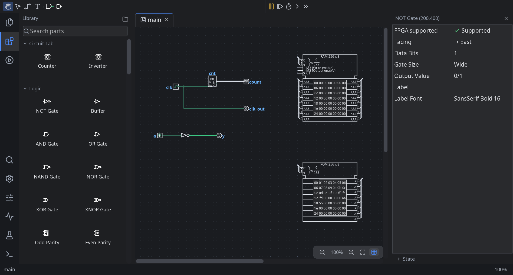
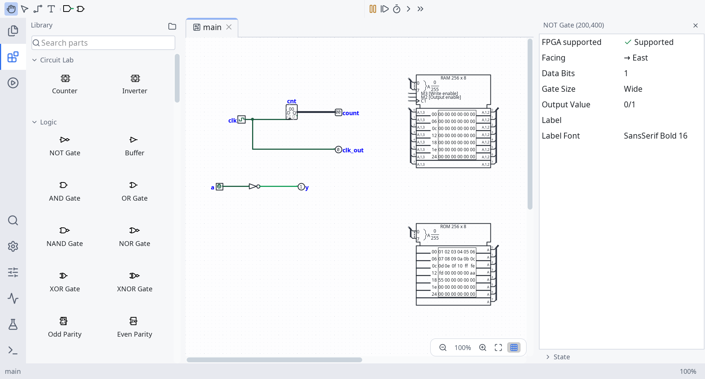

# Logisim Revolution

Design and simulate digital circuits in a local desktop app. Logisim Revolution combines a searchable parts picker, a tabbed circuit editor, an inspector for component settings, and built-in tools for testing and analyzing logic.

It is a fork of [Logisim-evolution](https://github.com/logisim-evolution/logisim-evolution). It keeps the familiar circuit file format and component IDs while developing its own interface and application identity.





## Try it from source

You need **JDK 21 or newer**. The Gradle wrapper is included; a separate Gradle installation is not needed.

```bash
git clone https://git.briggen.dev/NilsBriggen/Logisim-Revolution.git
cd Logisim-Revolution
./gradlew run
```

On Windows, run `gradlew.bat run`. To build a portable JAR instead:

```bash
./gradlew shadowJar
java -jar build/libs/logisim-revolution-5.1.0dev-all.jar
```

The JAR filename follows the version in [gradle.properties](gradle.properties); adjust that command when the version changes. Platform installers can be built on their respective operating systems with `./gradlew createAll`. **No Revolution installers or package-store releases are advertised here until they are published and verified.**

## Make a first circuit

1. Choose **New** on the welcome screen. Use the parts picker search to find **Pin**, place two input pins, then add an **AND** gate and an **LED**.
2. Select the wiring tool and connect both pins to the gate inputs, then connect the gate output to the LED.
3. Use the poke tool to switch the inputs between 0 and 1. The LED lights when both inputs are 1.
4. Save your work as a `.circ` file. Select a component to change its settings in the inspector.

The [built-in help](src/main/resources/doc) and [project background](docs/docs.md) cover more concepts and examples.

## What you can build

- Combinational and sequential circuits, from small gates to reusable subcircuits.
- Signals and displays, memory, arithmetic, TTL components, and SoC designs.
- Truth tables, expression analysis, test vectors, timing diagrams, and signal logs.
- VHDL components and HDL export; board and FPGA workflows where supported by your hardware and toolchain.

The editor follows the system light or dark theme by default. UI zoom can be changed independently of circuit zoom.

## Files and settings

Revolution opens and saves the existing Logisim-evolution `.circ` format. Saved component and library identifiers are unchanged. On the first interactive launch, Revolution offers to copy compatible Evolution settings. Declining leaves Revolution on its own defaults. The two apps keep separate settings and recovery files; importing does not delete or modify Evolution's settings.

## Project and contributions

- [Source repository and bug reporting](https://git.briggen.dev/NilsBriggen/Logisim-Revolution)
- [Developer build and contribution notes](docs/developers.md)
- [Localization guide](docs/localization.md)
- [Full project credits](docs/credits.md)
- [License: GNU GPL version 3](LICENSE.md)

Logisim was created by Carl Burch. Logisim-evolution and its contributors developed the project further; Revolution builds on that work. See the [credits](docs/credits.md) and source headers for attribution. The new Revolution emblem and wordmark are included under the project's GPLv3 license.
